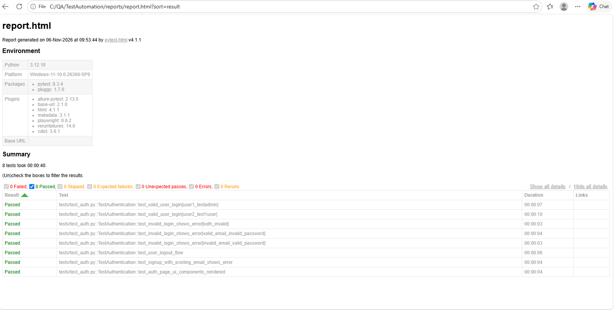

# UIAutomatio - Enterprise UI Test Automation Framework

[](https://playwright.dev/python/)
[](https://www.python.org/)
[](https://docs.pytest.org/)
[](https://allurereport.org/)
[](https://github.com)

A production-ready, enterprise-grade UI test automation framework built from scratch for [Automation Exercise](https://www.automationexercise.com/) utilizing **Python**, **pytest**, and **Playwright**.

---

## 🏛️ Architectural Highlights & Engineering Standards

- **Page Object Model (POM) + Component Object Pattern**: Clean separation of page logic and reusable shared components (such as `HeaderNavComponent`, `FooterComponent`, and modal dialogs).
- **Strict PEP 484 Type Hinting**: Comprehensive static typing (`Page`, `Locator`, `Optional[str]`, `dict`) throughout pages, fixtures, and helpers.
- **Accessibility-First & Resilient Locators**: Zero fragile absolute XPaths. Prioritizes accessibility roles (`get_by_role`), semantic labels, placeholders, and stable `data-qa` attributes (`login-email`, `login-password`, `signup-name`, etc.).
- **Automatic Ad & Overlay Suppression**: Automation Exercise aggressively displays Google Vignette interstitials and DoubleClick banner frames. The framework intercepts network traffic via Playwright route abortions in `tests/conftest.py` and provides automatic fallback dismissal in `BasePage`.
- **Parallel Execution & Self-Healing Retries**: Configured out of the box for parallel execution with `pytest-xdist` (`-n auto`) and transient failure recovery with `pytest-rerunfailures`.
- **Unified Observability & Failure Diagnostics**: Centralized structured logging powered by `Loguru`, combined with failure hooks that automatically capture full-page screenshots and Playwright trace archives (`.zip`) attached to both Allure and standalone HTML reports.

---

## 📁 Repository Structure

```text
├── .github/
│   └── workflows/
│       └── e2e-tests.yml        # Multi-browser matrix CI pipeline with artifact upload
├── config/
│   ├── __init__.py
│   └── settings.py              # Pydantic-based centralized settings & .env parser
├── pages/
│   ├── __init__.py
│   ├── base_page.py             # Base Page wrapper with explicit waits, logging, ad mitigation
│   ├── components/
│   │   ├── __init__.py
│   │   ├── header_nav.py        # Top navigation component (Home, Products, Cart, Auth, Logout)
│   │   └── footer.py            # Footer component & newsletter subscription widget
│   ├── home_page.py             # Home page actions & hero carousel
│   ├── login_page.py            # Authentication, registration, and form error validation
│   └── products_page.py         # Catalog, search, product detail view, and cart confirmation modal
├── tests/
│   ├── __init__.py
│   ├── conftest.py              # Pytest hooks, fixtures (browser context, ad blocker, failure hooks)
│   ├── test_auth.py             # Login, logout, invalid credentials, existing user signup tests
│   └── test_products.py         # Catalog browsing, keyword search, details, and add-to-cart tests
├── test_data/
│   ├── __init__.py
│   ├── models.py                # Pydantic data models for test schemas
│   └── users.json               # Seed test data for authentication and registration
├── utils/
│   ├── __init__.py
│   └── logger.py                # Structured enterprise action logger (Loguru)
├── .env.example                 # Template environment variables
├── .gitignore                   # Enterprise gitignore for Python & Playwright artifacts
├── pytest.ini                   # Pytest configuration, markers, reporting flags
├── requirements.txt             # Pinned enterprise dependencies
└── README.md                    # Setup, execution, parallelization, and debugging guide
```

---

## 🚀 Getting Started

### 1. Prerequisites
- **Python 3.10+** (Python 3.11 recommended)
- **Git**

### 2. Installation

1. **Clone the repository:**
   ```bash
   git clone <repository_url>
   cd UIAutomatio
   ```

2. **Create and activate a virtual environment:**
   ```bash
   # On macOS / Linux:
   python3 -m venv .venv
   source .venv/bin/activate

   # On Windows (PowerShell):
   python -m venv .venv
   .venv\Scripts\Activate.ps1

   Set-ExecutionPolicy -ExecutionPolicy RemoteSigned -Scope Process
   ```

3. **Install dependencies:**
   ```bash
   pip install --upgrade pip
   pip install -r requirements.txt
   ```

4. **Install Playwright browsers:**
   ```bash
   playwright install chromium firefox
   ```

5. **Configure environment:**
   ```bash
   cp .env.example .env
   ```

---

## ⚙️ Configuration (`.env`)

Configuration is managed via Pydantic in `config/settings.py`. Customize runtime settings in `.env`:

| Key | Default | Description |
|---|---|---|
| `BASE_URL` | `https://www.automationexercise.com` | Target web application base URL |
| `BROWSER` | `chromium` | Target browser engine (`chromium`, `firefox`, `webkit`) |
| `HEADLESS` | `true` | Run in headless mode (`true` or `false`) |
| `DEFAULT_TIMEOUT`| `15000` | Playwright action timeout in milliseconds |
| `SLOW_MO` | `0` | Delay in ms between actions (ideal for headed debugging) |
| `RECORD_TRACE` | `retain-on-failure` | Options: `off`, `on`, `retain-on-failure` |
| `RECORD_VIDEO` | `retain-on-failure` | Options: `off`, `on`, `retain-on-failure` |
| `LOG_LEVEL` | `INFO` | Logging level (`DEBUG`, `INFO`, `WARNING`, `ERROR`) |

---

## 🧪 Running Tests

### Run Smoke Suite
```bash
pytest -m smoke
```

### Run Authentication Tests (Phase 1 Module)
```bash
pytest tests/test_auth.py -v
```

### Run Products & Catalog Tests (Phase 2 Module)
```bash
pytest tests/test_products.py -v
```

### Run Regression Suite in Parallel (`pytest-xdist`)
```bash
# Utilize all available CPU cores
pytest -m regression -n auto

# Or run with 4 dedicated workers
pytest -n 4
```

### Run Headed for Visual Debugging
Override environment variables directly or pass CLI flags:
```bash
pytest tests/test_auth.py -o addopts="-vs"
```
*(Or set `HEADLESS=false` and `SLOW_MO=500` in `.env`)*

### Run with Automatic Flaky Test Retries
```bash
pytest --reruns 2 --reruns-delay 1
```

---

## 📊 Test Reporting & Diagnostics

### 1. Pytest HTML Report
A self-contained HTML report with embedded failure screenshots is automatically generated:
```bash
# Report path:
reports/report.html
```


### 2. Allure Report
Allure test results are recorded to `reports/allure-results`. To view the interactive dashboard:
```bash
allure serve reports/allure-results
```

### 3. Inspecting Playwright Failure Traces
When a test fails, Playwright saves a complete action-and-network trace in `reports/traces/`:
```bash
playwright show-trace reports/traces/<test_name>_trace.zip
```
This opens the Playwright Trace Viewer, enabling full step-by-step DOM inspection, network waterfall analysis, and console log replays.

---

## 🔄 CI/CD Pipeline (GitHub Actions)

The framework includes a production-grade CI workflow (`.github/workflows/e2e-tests.yml`):
- **Matrix Testing**: Concurrently executes tests across **Chromium** and **Firefox**.
- **Automated Caching**: Caches pip dependencies and Playwright browser binaries for fast execution times.
- **Artifact Upload**: Retains HTML reports, failure screenshots, video recordings, and trace archives for 14 days on every pull request and push to `main`.
- **Manual Dispatch**: Supports running ad-hoc suites via GitHub Actions UI with custom pytest markers (`smoke`, `regression`, `auth`, `products`).

